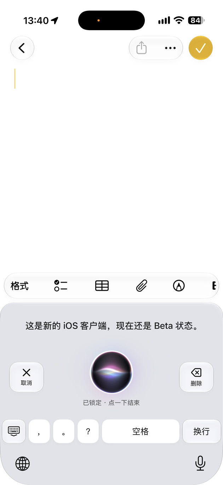
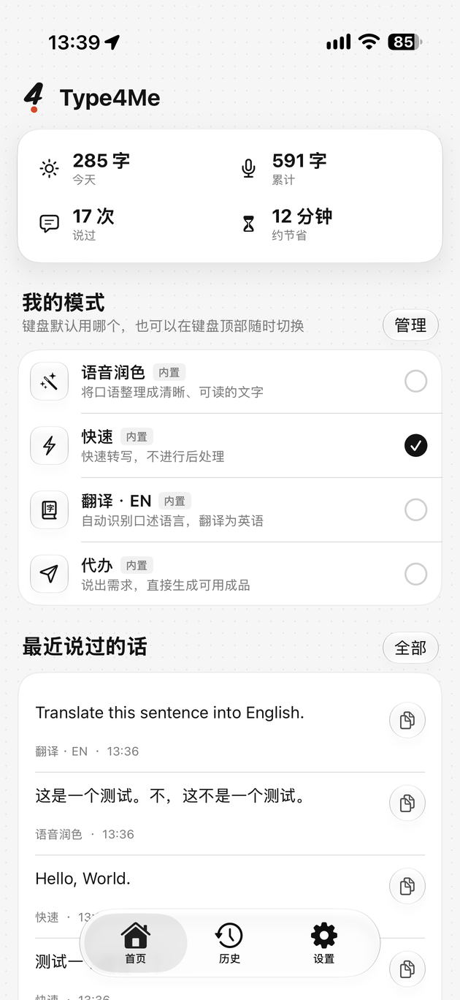
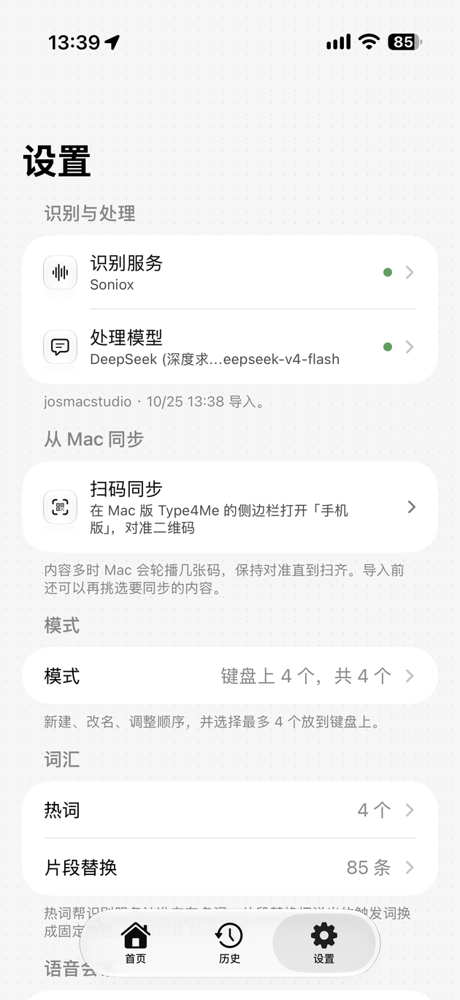
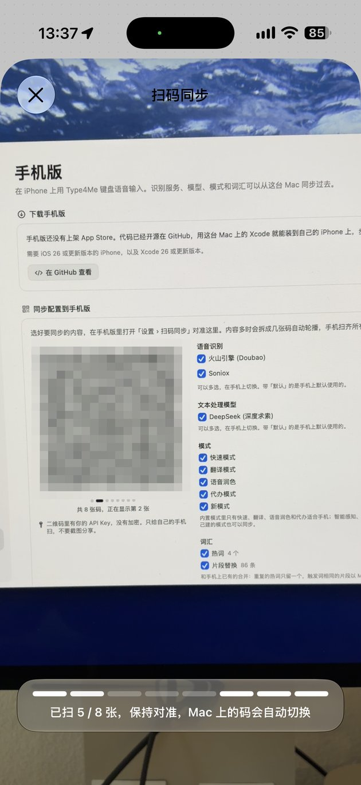

  <b>简体中文</b> · <a href="#english">English</a>

  <picture>
    <source media="(prefers-color-scheme: dark)" srcset="docs/images/header-dark.svg" />
    
  </picture>

  
  
  
  

Type4Me 是一款免费开源的 macOS 语音输入法。按下快捷键说话，文字边说边出现在光标处；同一段话还可以一键润色、翻译、向 AI 提问，或者直接操作 Mac。识别引擎、大模型和 Prompt 都由你选，历史记录存在本机，随时可以导出。

## 下载

| 版本 | 说明 | 大小 |
| --- | --- | --- |
| ✨ **[云端版（推荐）](https://github.com/joewongjc/type4me/releases/download/v3.0.0/Type4Me-v3.0.0-cloud.dmg)** | Intel 与 Apple Silicon 通用。需要自备语音识别和大模型的 API Key，识别推荐火山引擎（豆包）或 Soniox。[配置指引](https://my.feishu.cn/wiki/QdEnwBMfUi0mN4k3ucMcNYhUnXr) | ~18 MB |
| **[本地版](https://github.com/joewongjc/type4me/releases/download/v3.0.0/Type4Me-v3.0.0-local-apple-silicon.dmg)** | 仅支持 Apple Silicon。内置 SenseVoice + Qwen3-ASR 离线识别，约占 8 GB 内存，建议 32 GB 以上的机器使用；文本处理仍需 API Key 或本地 Ollama | ~720 MB |

需要 macOS 14 (Sonoma) 及以上。两个版本共用一份配置，可以随时互相替换。安装包已通过 Apple 公证，首次打开按引导授予**麦克风**和**辅助功能**权限就能用。

## 手机版（测试中）

iPhone 上的 Type4Me 是一个语音键盘：任何输入框切到 Type4Me，按住说话，松手出字，同样支持润色、翻译、代办等模式和热词、片段替换。识别服务、模型、模式和词汇可以在 Mac 版侧边栏的「手机版」里扫码同步过去，不用在手机上重新填 API Key。

手机版已开放 TestFlight 公开测试：在 iPhone 上打开 [https://testflight.apple.com/join/57f5897s](https://testflight.apple.com/join/57f5897s)，按提示装好 TestFlight 后就能安装（需要 iOS 26）。App Store 版还在审核中。也可以用 Xcode 自己编译安装，步骤见 [iOS/README.md](iOS/README.md)。

<table>
  <tr>
    <td width="25%"></td>
    <td width="25%"></td>
    <td width="25%"></td>
    <td width="25%"></td>
  </tr>
  <tr>
    <td align="center">键盘：按住说话，松手出字</td>
    <td align="center">首页：用量与我的模式</td>
    <td align="center">设置：识别、模型与词汇</td>
    <td align="center">扫码同步 Mac 上的配置</td>
  </tr>
</table>

## 演示

<video src="https://github.com/user-attachments/assets/d5ad6da9-b924-4fd6-9812-d0d9868563a4" width="720" controls>Type4Me 演示视频</video>

每个模式可以绑定多个全局快捷键，每个快捷键单独设为「按住说话」或「按一下开关」。

## 内置模式 + 自由定义

| 模式 | 用途 |
| --- | --- |
| **快速模式** | ⚡️仅做语音识别，速度最快 |
| **智能感知** | 日常主力模式，支持改口、去掉口头禅，并参考当前 App 和上下文调整措辞 |
| **翻译模式** | 自动翻译成18 种目标语言中的任意一种 |
| **随便问** | 选中屏幕上的文字，直接语音提问；支持连续追问，会话会保存下来 |
| **Mac 操作** | 说一句「打开 Safari」「音量调到 30」「锁屏」就能执行 |
| **语音润色** | 按固定规则把口语整理成书面文字，输出风格稳定 |
| **Prompt 优化** | 把一句需求扩写成完整的 Prompt，适合发给 ChatGPT、Claude |
| **代办模式** | 结合语音、选中文字和剪贴板，直接生成可用的成品 |

拿不准用哪个，就用**智能感知**。你也可以新建模式：Prompt 模板里可以用 `{text}`（本次语音）、`{selected}`（选中的文字）、`{clipboard}`（剪贴板）三个变量，把任意文本处理流程绑到一个快捷键上。不方便说话的时候，按手动输入快捷键直接打字，同样可以调用这些模式。

各模式的示例和适用场景见 [模式与功能详解](docs/usage/modes.md)。

## 功能扩展

- **本地、云端语音识别**：下载本地版，可用 SenseVoice + Qwen3-ASR 识别，完全免费；云端支持火山引擎（豆包）、Soniox、OpenAI、Groq、Mistral AI、腾讯云等 18 家服务。阶跃星辰、百炼、Gemini、ElevenLabs、Grok 和 Azure MAI 可切换实时流式或批量识别，也可接入自定义 HTTP 批量接口。
- **大模型随意换**：豆包、DeepSeek、Kimi、智谱、MiniMax、小米 MiMo、OpenAI、Claude、Gemini、OpenRouter，也可以接 Ollama、本机 Magpie 网关或任意 OpenAI 兼容接口，或通过 Codex CLI 使用本机已登录账号；兼容接口还可设置推理强度。
- **Magpie 联动插件**：在 [Magpie](https://usemagpie.ai) 插件市场安装社区插件「Type4Me」（或运行 `magpie plugin add @magpie-community/agent-type4me`），可将 Type4Me 接入 Magpie 的 Agent 页。直接复用已配置的大模型订阅与 API Key，并在两边菜单栏双向实时同步模型。
   
  
- **语音改口**：刚输入的文字有错，按 `Fn` + `R` 说「改成下午 2 点」，只改那一处，可以一键或用语音撤销。
- **词汇管理**：热词提高专有名词的识别率，片段替换可以把「我的邮箱」换成真实地址。装上 [type4me-vocab-skill](https://github.com/joewongjc/type4me-vocab-skill) 后，对 AI Agent 说一句「Qwen3.5 不要识别成 Queen 3.5」，它会帮你把词库维护好。
- **菜单栏控制中心**：在菜单栏查看录音状态，切换模式、麦克风、识别引擎、文本处理模型和翻译目标语言。
- **录音显示按模式定制**：为每种模式设置独立的录音球、录音条和提示；也可以拖动录音条到屏幕上的合适位置并吸附边缘。
- **历史与用量**：保存每次的原始识别和处理结果，支持搜索和导出 CSV；用量看板按模型统计 Token、预估费用和耗时。首页显示输入时长、字数和活跃热力图。
- **本地备份**：每天自动备份历史、模式、词汇、快捷键和配置，保留最近 7 份。
- **URL Scheme**：用 `type4me://toggle` 等命令接入 Stream Deck、快捷指令、Raycast、Alfred 或脚本，后台调用不会抢走焦点。见 [命令参考](docs/usage/url-scheme.md)。

## 界面预览

<table>
  <tr>
    <td width="50%"></td>
    <td width="50%"></td>
  </tr>
  <tr>
    <td></td>
    <td></td>
  </tr>
</table>

## 使用建议

- **识别用云端引擎**：费用很低。作者高强度用了约 5 万字（5 小时），花了 5 块钱左右，火山引擎新用户还送 40 小时。本地模型效果不错，但很吃内存，而且 SenseVoice 识别英文单词偏弱。
- **大模型选轻量、不带思考的**：整理文字用不上推理。作者自己用 Seed-2.0-lite；关不掉思考的模型（比如 MiniMax M2.7）会慢很多。如果你觉得处理慢，欢迎在 Issue 里告诉我用的是哪家、哪个模型。
- **装上词库 Skill**：专有名词识别不准，是所有语音输入法的通病。配合 [Skill](https://github.com/joewongjc/type4me-vocab-skill) 用上一两天，常见的错词基本都能纠正过来。

## 为什么做 Type4Me

市面上的语音输入法，至少有下面一个问题：贵（$30/月）、封闭（记录导不出来）、改不了（不能自定义 Prompt）、慢（强制优化加上网络延迟）。

作为某款最贵识别工具的前粉丝，我的感受一直是：**「它怎么可以这么好用，又这么难用」**。况且，也不是每句话都需要说得工工整整。

## 参与贡献

欢迎提交 Issue 和 PR。这个项目全部是我用 Claude Code 写的；收到 PR，哪怕有 bug，我也不会漏掉任何人的贡献，合并之后再改就好。

从源码构建、签名和架构说明见 [CONTRIBUTING.md](.github/CONTRIBUTING.md)，设计文档从 [docs/README.md](docs/README.md) 进入。想让 AI Agent 帮你从源码部署，把这个仓库的链接发给它就行。

## 致谢

[SenseVoice](https://github.com/FunAudioLLM/SenseVoice) · [streaming-sensevoice](https://github.com/pengzhendong/streaming-sensevoice) · [asr-decoder](https://github.com/pengzhendong/asr-decoder) · [sherpa-onnx](https://github.com/k2-fsa/sherpa-onnx) · [Qwen3-ASR](https://github.com/QwenLM/Qwen3-ASR) · [mlx-qwen3-asr](https://github.com/moona3k/mlx-qwen3-asr)

## Star History

<a href="https://star-history.dera.page/#joewongjc/type4me&type=date&legend=top-left">
  <picture>
    <source media="(prefers-color-scheme: dark)" srcset="https://star-history.dera.page/svg?repos=joewongjc%2Ftype4me&type=date&theme=dark&legend=top-left" />
    
  </picture>
</a>

## 许可证

[MIT License](LICENSE)

 

---

  <a href="#zh-cn">简体中文</a> · <b>English</b>

  <picture>
    <source media="(prefers-color-scheme: dark)" srcset="docs/images/header-en-dark.svg" />
    
  </picture>

  
  
  
  

Type4Me is a free, open-source voice input app for macOS. Hold a hotkey and talk — text streams in at your cursor as you speak. The same hotkey workflow can polish what you said, translate it, ask AI about it, or turn it into a Mac action. You choose the speech engine, the LLM and the prompts; your history stays on your Mac and can be exported anytime.

## Download

| Edition | Details | Size |
| --- | --- | --- |
| ✨ **[Cloud (recommended)](https://github.com/joewongjc/type4me/releases/download/v3.0.0/Type4Me-v3.0.0-cloud.dmg)** | Intel and Apple Silicon. Bring your own speech and LLM API keys; Volcano Engine (Doubao) or Soniox recommended for recognition. [Setup guide](https://my.feishu.cn/wiki/QdEnwBMfUi0mN4k3ucMcNYhUnXr) | ~18 MB |
| **[Local](https://github.com/joewongjc/type4me/releases/download/v3.0.0/Type4Me-v3.0.0-local-apple-silicon.dmg)** | Apple Silicon only. Bundles SenseVoice + Qwen3-ASR for offline recognition (~8 GB RAM, 32 GB+ Macs recommended). Text processing still needs an API key or local Ollama | ~720 MB |

Requires macOS 14 (Sonoma) or later. Both editions share the same settings, so you can switch anytime. The app is notarized by Apple; on first launch, grant **Microphone** and **Accessibility** access as prompted.

## Mobile (beta)

Type4Me on iPhone is a voice keyboard: switch to it in any text field, hold to talk and let go to type. Modes such as Voice Polish, Translation and Handle It work there too, along with hotwords and snippets. Speech services, models, modes and vocabulary sync over by scanning a QR code on the Mobile page in the Mac app's sidebar, so there are no API keys to retype.

The mobile app is in public beta on TestFlight: open [https://testflight.apple.com/join/57f5897s](https://testflight.apple.com/join/57f5897s) on your iPhone and follow the prompts (iOS 26 required). The App Store version is still in review. You can also build and install it yourself with Xcode; see [iOS/README.md](iOS/README.md) (in Chinese).

<table>
  <tr>
    <td width="25%"></td>
    <td width="25%"></td>
    <td width="25%"></td>
    <td width="25%"></td>
  </tr>
  <tr>
    <td align="center">Keyboard: hold to talk, release to type</td>
    <td align="center">Home: usage and your modes</td>
    <td align="center">Settings: speech, models and vocabulary</td>
    <td align="center">Scan to sync your Mac setup</td>
  </tr>
</table>

## Demo

<video src="https://github.com/user-attachments/assets/d5ad6da9-b924-4fd6-9812-d0d9868563a4" width="720" controls>Type4Me demo video</video>

Each mode can have several global hotkeys, and each hotkey can be hold-to-talk or press-to-toggle.

## Built-in modes + your own

| Mode | What it does |
| --- | --- |
| **Quick Mode** | ⚡️ Speech recognition only — the fastest path |
| **Intelli Sense** | Your everyday mode: handles self-corrections, drops filler words, and adapts wording to the current app and context |
| **Translation** | Translates automatically into any of 18 target languages |
| **Ask Anything** | Select text anywhere and ask about it by voice; follow-ups are kept as conversations |
| **Mac Actions** | "Open Safari", "Volume to 30", "Lock screen" — said and done |
| **Voice Polish** | Turns speech into clean written text with a consistent, predictable style |
| **Prompt Optimization** | Expands a one-line request into a well-structured prompt for ChatGPT or Claude |
| **Task Delegation** | Combines your voice, the selection and the clipboard to produce a finished result |

Not sure which one to use? Start with **Intelli Sense**. You can also create your own modes: prompt templates accept `{text}` (what you said), `{selected}` (selected text) and `{clipboard}`, so any text workflow can live behind one hotkey. When you can't talk, the manual input hotkey lets you type instead and still run any mode.

Examples and use cases for each mode: [Modes & Features](docs/usage/modes.en.md).

## Extended features

- **Local and cloud recognition**: the Local edition runs SenseVoice + Qwen3-ASR on your Mac, completely free; in the cloud, choose from 18 services including Volcano Engine (Doubao), Soniox, OpenAI, Groq, Mistral AI, and Tencent Cloud. StepFun, Bailian, Gemini, ElevenLabs, Grok and Azure MAI offer a choice of real-time streaming or batch recognition, and custom HTTP batch endpoints are supported too.
- **Any LLM**: Doubao, DeepSeek, Kimi, Zhipu, MiniMax, Xiaomi MiMo, OpenAI, Claude, Gemini and OpenRouter, plus Ollama, the local Magpie gateway and any OpenAI-compatible endpoint. You can also use your locally signed-in account through Codex CLI. Compatible endpoints can set reasoning effort.
- **Magpie integration plugin**: install the community plugin "Type4Me" from the [Magpie](https://usemagpie.ai) plugin marketplace (or run `magpie plugin add @magpie-community/agent-type4me`) to add Type4Me to Magpie's Agents page. It lets you reuse subscriptions and API keys already configured in Magpie, with two-way real-time model syncing between both menu bars.
   
  
- **Voice Revise**: Spotted a mistake? Press `Fn` + `R` and say "make it 2 PM" — only that part changes, and you can undo by button or voice.
- **Vocabulary**: hotwords improve recognition of names and jargon; snippets expand phrases like "my email" into the real address. With [type4me-vocab-skill](https://github.com/joewongjc/type4me-vocab-skill) installed, tell your AI agent "don't transcribe Qwen3.5 as Queen 3.5" and it maintains your vocabulary for you.
- **Menu bar control center**: see recording status and switch mode, microphone, speech engine, LLM and translation target from the menu bar.
- **Recording display per mode**: choose a different orb, bar style and hints for each mode, then drag the recording bar where it works best and snap it to screen edges.
- **History & usage**: every raw transcript and processed result is saved, searchable and exportable to CSV; the usage dashboard tracks tokens, estimated cost and latency per model. The home page shows time spoken, word count and an activity heatmap.
- **Local backups**: history, modes, vocabulary, hotkeys and settings are snapshotted daily; the latest seven are kept.
- **URL Scheme**: drive recording from Stream Deck, Shortcuts, Raycast, Alfred or scripts with commands like `type4me://toggle`, without stealing focus. See the [command reference](docs/usage/url-scheme.en.md).

## Screenshots

<table>
  <tr>
    <td width="50%"></td>
    <td width="50%"></td>
  </tr>
  <tr>
    <td></td>
    <td></td>
  </tr>
</table>

## Tips

- **Use a cloud speech engine**: it's cheap. About 50,000 characters (5 hours) of heavy use cost the author roughly ¥5 (~$0.70), and Volcano Engine gives new users 40 free hours. Local models work, but they use a lot of memory and SenseVoice is weak on English words.
- **Pick a small, non-reasoning LLM**: cleaning up text doesn't need reasoning. The author uses Seed-2.0-lite; models whose thinking can't be turned off (e.g. MiniMax M2.7) are much slower. If processing feels slow, open an Issue with your provider and model.
- **Install the vocabulary Skill**: every voice input tool struggles with proper nouns. After a day or two with the [Skill](https://github.com/joewongjc/type4me-vocab-skill), your recurring mistakes are fixed for good.

## Why Type4Me

Every voice input tool I tried had at least one of these problems: expensive ($30/month), closed (no history export), rigid (no custom prompts), or slow (forced rewriting plus network latency).

As a former fan of the priciest one, my feeling was always: **"How can it be this good and this frustrating at the same time?"** And not everything you say needs to sound polished.

## Contributing

Issues and PRs are welcome. I built the whole project with Claude Code, and I never drop anyone's contribution — even if a PR has bugs, we merge first and fix later.

Building from source, code signing and architecture are covered in [CONTRIBUTING.md](.github/CONTRIBUTING.md); design docs start at [docs/README.md](docs/README.md). To have an AI agent deploy from source, just give it this repository's link.

## Acknowledgments

[SenseVoice](https://github.com/FunAudioLLM/SenseVoice) · [streaming-sensevoice](https://github.com/pengzhendong/streaming-sensevoice) · [asr-decoder](https://github.com/pengzhendong/asr-decoder) · [sherpa-onnx](https://github.com/k2-fsa/sherpa-onnx) · [Qwen3-ASR](https://github.com/QwenLM/Qwen3-ASR) · [mlx-qwen3-asr](https://github.com/moona3k/mlx-qwen3-asr)

## License

[MIT License](LICENSE)
